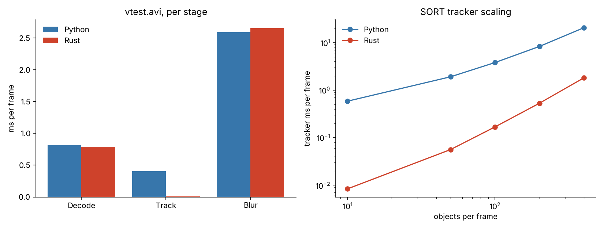

# vision-pipeline-rs

The tracking and anonymisation stage of an edge video pipeline, written twice: once in
Python (numpy + scipy + OpenCV) and once in Rust (nalgebra + the `opencv` crate). Both run on
the same frames and the same detections, so the timings compare like for like, and they
produce **byte-identical tracks and pixel-identical blurred frames**.



## What the stage does

```
frame ──► detections (fixed CSV) ──► SORT tracker ──► blur every tracked box ──► output frame
                                     Kalman + IoU       OpenCV GaussianBlur
                                     + Hungarian
```

- **SORT tracker** ([Bewley et al., 2016](https://arxiv.org/abs/1602.00763)): constant-velocity
  Kalman filter per object (state `[cx, cy, area, aspect, vx, vy, va]`), IoU cost matrix,
  optimal assignment, and a track lifecycle (`max_age=1`, `min_hits=3`, `iou=0.3`).
- **Anonymisation**: Gaussian blur (31x31) over each confirmed track box, as you would for
  faces or number plates before footage leaves the device.
- Detections are computed once with OpenCV's HOG people detector (`python/detect.py`) and
  stored in `data/detections.csv`, so detector cost and detector noise stay out of the comparison.

## Results

Intel Xeon @ 2.10 GHz, single thread, OpenCV 4.6.0 on both sides, median of 5 runs.
Full tables in [results/RESULTS.md](results/RESULTS.md).

| ms per frame (vtest.avi, 795 frames) | Python | Rust | Speedup |
|---|---:|---:|---:|
| Decode (OpenCV) | 0.815 | 0.789 | 1.0x |
| SORT tracking | 0.407 | 0.011 | **37x** |
| Blur tracked boxes (OpenCV) | 2.589 | 2.654 | 1.0x |
| Total | 3.811 | 3.454 | 1.1x |

| Tracker only, synthetic crowd | 10 objects | 50 | 100 | 200 | 400 |
|---|---:|---:|---:|---:|---:|
| Python (ms/frame) | 0.583 | 1.903 | 3.795 | 8.293 | 20.526 |
| Rust (ms/frame) | 0.008 | 0.056 | 0.168 | 0.530 | 1.807 |
| Speedup | 70x | 34x | 23x | 16x | 11x |

### What the numbers say

- **Rust does not make OpenCV faster.** Decode and blur call the same C++ code from both
  languages, so they cost the same. On a quiet scene the whole stage is only 1.1x faster,
  because blur dominates.
- **The win is in the code between OpenCV calls.** The tracker is small-matrix maths in a
  per-object loop, which is where Python's interpreter and numpy's per-call overhead add up.
  In Rust the 7x7 Kalman matrices are fixed-size and live on the stack, and the IoU and
  assignment buffers are reused across frames, so a frame does almost no allocation.
- **The speedup shrinks as scenes get crowded** (70x at 10 objects, 11x at 400). Per-object
  overhead stops mattering, and the O(N²) IoU matrix and O(N³) assignment take over; in
  Python those already run in vectorised numpy and scipy's C solver. The next step would be
  spatial gating (only score pairs whose boxes are close) rather than more language speed.
- At 400 objects Python spends 20 ms per frame on tracking alone, which is more than half
  the budget for 30 fps. Rust stays under 2 ms.

## Matching outputs

A speed comparison means nothing if the two programs do different work, so the port is
checked for exact equality:

- `results/tracks_python.csv` and `results/tracks_rust.csv` are compared with `cmp` (same
  IDs, same boxes to 4 decimals) on the video and on every synthetic crowd size.
- A CRC32 over every blurred frame matches. That needed `BORDER_ISOLATED` on the Rust side:
  a numpy slice has no parent image, but an OpenCV ROI does, and without the flag the kernel
  reads pixels outside the box.
- One small change from the original SORT: unmatched detections spawn new tracks in index
  order. When the assignment has ties, scipy and the Rust solver can leave different rows
  unassigned, which would hand out the same IDs to different people.

## Layout

```
python/detect.py         one-off HOG detections -> data/detections.csv
python/sort.py           SORT reference implementation (numpy + scipy)
python/pipeline.py       decode -> track -> blur, per-stage timing
src/sort.rs              SORT port (nalgebra fixed-size matrices)
src/hungarian.rs         rectangular assignment solver (Hungarian with potentials)
src/blur.rs              in-place ROI blur
src/main.rs              same CLI and timing as pipeline.py
bench/make_synthetic.py  deterministic crowded scenes for the scaling test
bench/run_all.sh         reproduces every number above
bench/report.py          writes results/RESULTS.md and the chart
```

## Run it

Ubuntu 24.04:

```bash
sudo apt install libopencv-dev clang libclang-dev python3-opencv python3-scipy python3-matplotlib
cargo test --release
PYTHON=python3 ./bench/run_all.sh
```

The Python side must use the same OpenCV build as the Rust side (here Ubuntu's
`python3-opencv`), otherwise decode and blur are comparing two different libraries.
`bench/run_all.sh` downloads `vtest.avi` from the OpenCV samples.

## Licence

MIT. `vtest.avi` comes from the [OpenCV samples](https://github.com/opencv/opencv/tree/4.x/samples/data) and is not redistributed here.
